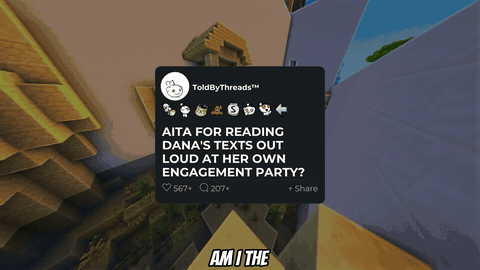

# AI Long-Form Video Generator

An automated Python pipeline that produces 8-12 minute narrated story videos for
YouTube: chaptered scripts, synced captions, AI-illustrated thumbnails and
chapter timestamps in the description, uploaded on a schedule.
It ran unattended daily for a live YouTube channel.

<p align="center">
  
  
  <br><em>Left: opening of a generated video. Right: its AI-generated thumbnail.</em>
</p>

```
Claude (original ~2,000-word story) -> Claude (5-7 named chapters + teaser)
   -> Edge TTS -> Whisper word alignment -> chapter timestamps
   -> MoviePy render (intro card, captions, music, outro)
   -> AI thumbnail (Claude plans -> GPT Image renders -> Claude vision QA)
   -> YouTube upload + playlist -> SQLite job tracking
```

## Highlights

- **Long-form LLM writing**: `story_generator.py` prompts Claude for an
  original story with a strict structure (setup, escalation, update,
  unresolved ending) and length targets tied to narration speed.
- **Chaptering**: `processor_longform.py` splits the story into named chapters;
  after TTS, `resolve_chapter_timestamps()` maps each chapter to its exact start
  time using Whisper word timings, producing YouTube chapter markers.
- **AI thumbnail with self-check**: in `ai_thumbnail.py`, Claude designs the
  headline and scene as JSON, GPT Image renders it (optionally matching a style
  reference image), then Claude vision verifies the headline is spelled
  correctly and retries if not. Falls back to a Pillow-rendered thumbnail.
- **Video assembly**: `video_builder_longform.py` (MoviePy 2) builds a 16:9
  edit with an animated post card, word-synced captions,
  background music and a branded outro.
- **Publishing and state**: `poster.py` (YouTube OAuth, resumable upload, custom
  thumbnail, playlist insert) and `db.py` (SQLite job and status tracking).
- **Two sources**: `main_longform_generated.py` writes original stories;
  `main_longform.py` instead scrapes long, high-engagement Reddit posts
  (`scraper_longform.py`).

## Tech stack

Python, Anthropic Claude API (text + vision), OpenAI GPT Image, Edge TTS,
OpenAI Whisper, MoviePy, Pillow, NumPy, SQLite, APScheduler,
YouTube Data API v3 / OAuth 2.0

## Project layout

| File | Role |
|---|---|
| `main_longform_generated.py` | Orchestrator for generated stories (default) |
| `main_longform.py` | Orchestrator for scraped Reddit posts |
| `story_generator.py`, `processor_longform.py`, `llm.py` | Claude prompts and calls |
| `scraper_longform.py` | Reddit source |
| `tts.py` | Narration and word timestamps |
| `video_builder_longform.py`, `post_card.py`, `music.py`, `outro.py` | Rendering |
| `ai_thumbnail.py`, `thumbnail.py` | AI and fallback thumbnails |
| `poster.py` | YouTube upload |
| `db.py`, `db_updates.py`, `db_posting_helpers.py` | SQLite schema and helpers |
| `test_video_longform.py`, `test_youtube_auth.py` | Smoke tests |

## Setup

Requires Python 3.10+ and [FFmpeg](https://ffmpeg.org/download.html) on your PATH.

```bash
python -m venv venv
venv\Scripts\activate          # macOS/Linux: source venv/bin/activate
pip install -r requirements.txt
cp .env.example .env           # then fill in your keys
```

1. Add media to `assets/`; see [assets/README.md](assets/README.md).
2. For uploads, create an OAuth "Desktop app" client in Google Cloud with the
   YouTube Data API v3 enabled, save it as `youtube_secrets.json`, then run
   `python test_youtube_auth.py` once to authorize.

## Running

```bash
python main_longform_generated.py              # one generated-story video
python main_longform_generated.py --schedule   # daily schedule
python main_longform.py                        # scraped-Reddit variant
python test_video_longform.py                  # render without uploading
python ai_thumbnail.py 12 13                   # regenerate thumbnails for job ids
```

Output lands in `output/` (audio, timestamps, videos, thumbnails).

## Notes

- AI-generated content: YouTube requires disclosure; the uploader sets this
  in the video metadata and description.
- All secrets live in `.env` and `youtube_*.json`, which are git-ignored.

## License

Code is released under the [MIT License](LICENSE). Media assets are not included.
